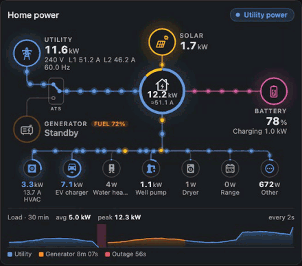
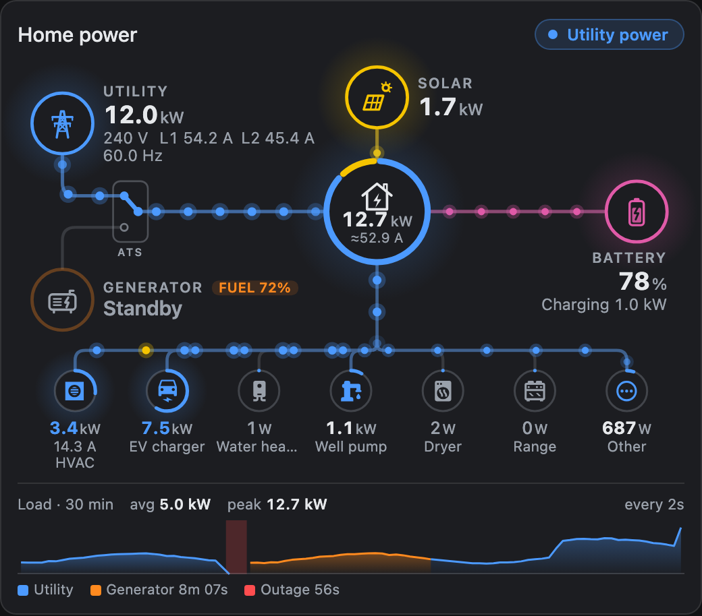
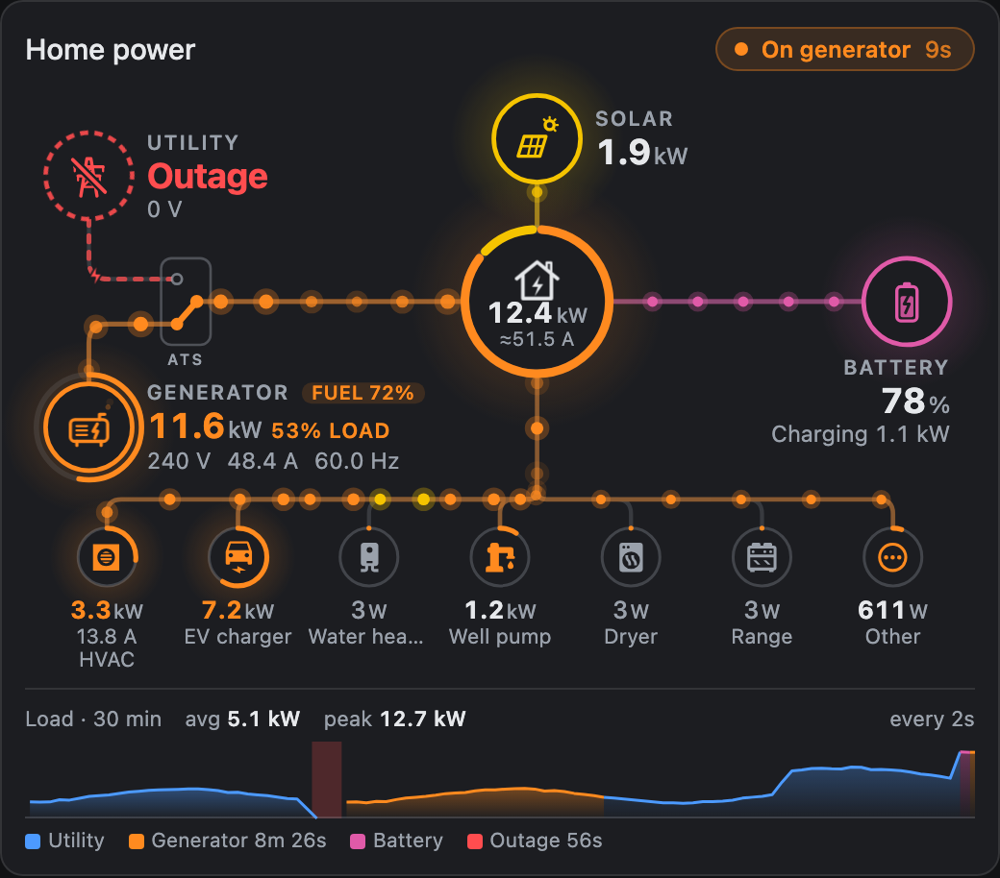
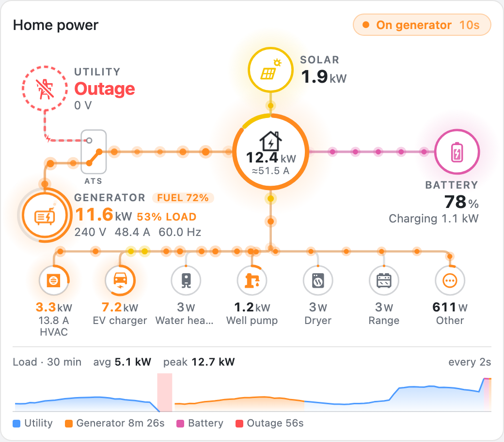

# Energy Monitor Card

[](https://hacs.xyz/docs/faq/custom_repositories)
[](https://github.com/kedube/ha-energy-monitor-card/releases/latest)
[](https://github.com/kedube/ha-energy-monitor-card/actions/workflows/release.yml)
[](LICENSE)

A Home Assistant dashboard card that shows where your home's power is coming from and where it's going. It supports **utility, standby generator, solar and battery** sources, and you can watch the **transfer switch cut over** when the utility fails.



The design follows [Compact Power Card](https://github.com/pacemaker82/Compact-Power-Card): a central home, sources around it, and your heavy loads along the bottom. This card adds a generator and an automatic transfer switch (ATS).

| On utility | On generator | Light theme |
| --- | --- | --- |
|  |  |  |

## What it shows

- **Transfer switch.** Utility (top left) and generator (bottom left) both feed an ATS. Its blade points at whichever source is connected. When power fails, the blade swings to the generator with a spark, and the new source's colour flows down the wires into the home.
- **Outage timeline.** A status pill tracks each stage: utility lost → generator starting → on generator → utility restored → cooldown. The pill shows how long each stage has lasted, and a banner announces every transition.
- **Animated flow.** Particles move along each wire at a speed set by the power level. Utility power glides steadily. Generator power pulses with the engine. Each particle keeps its colour, so after a cut-over the new source visibly replaces the old one.
- **Volts, amps and watts.** Each source shows its voltage, current (per leg for split-phase), frequency and power. Current is estimated from P ÷ V when you have no current sensor, and estimates are marked with **≈**.
- **Generator status.** A ring gauge shows load against rated output and turns red above 85 %. The card also shows fuel level, and an engine rumble and exhaust puffs animate while it runs.
- **Heavy loads.** Each device's ring shows its share of the whole-home load. Devices above `high_load` are highlighted. Wires to active devices carry particles coloured by the current source mix.
- **Home ring.** The home ring is split by source mix, for example 80 % utility and 20 % solar. It goes dark with a dashed red ring when nothing is supplying the home, and the house icon flickers when the outage starts.
- **Load trend.** A strip at the bottom shows load over a configurable window, shaded by the source that carried it. Outages appear as red bands. The strip also shows average, peak and total time on the generator. It back-fills from recorder history, and you can hover over it to read individual values.
- **Update interval.** Readings and trend samples refresh every `update_interval` seconds. A change of source always shows at once.

## Installation

### HACS (custom repository)

1. In HACS, open the ⋮ menu and choose **Custom repositories**.
2. Add this repository's URL with type **Dashboard**.
3. Search for **Energy Monitor Card**, download it, and reload your browser.

### Manual

1. Copy `dist/energy-monitor-card.js` to `<config>/www/energy-monitor-card.js`.
2. Go to **Settings → Dashboards → ⋮ → Resources** and add `/local/energy-monitor-card.js` as a **JavaScript module**.
3. Reload the browser.

## Quick start

```yaml
type: custom:energy-monitor-card
grid:
  entity: sensor.grid_power            # + import / − export
  status: binary_sensor.utility_power  # on while utility is present
generator:
  entity: sensor.generator_power
  running: binary_sensor.generator_running
```

The visual editor covers every option below, including the device list.

## Full example

```yaml
type: custom:energy-monitor-card
title: Home power
update_interval: 5          # seconds
trend_window: 120           # minutes
grid:
  entity: sensor.grid_power
  status: binary_sensor.utility_power
  voltage: sensor.utility_voltage
  current_legs: [sensor.grid_l1_current, sensor.grid_l2_current]
  frequency: sensor.grid_frequency
generator:
  entity: sensor.generator_power
  running: sensor.generator_status    # e.g. Ready / Cranking / Running / Exercising
  voltage: sensor.generator_voltage
  current: sensor.generator_current
  frequency: sensor.generator_frequency
  fuel: sensor.propane_tank_level
  rated_power: 22000                  # W, enables the load gauge
transfer_switch:
  entity: sensor.ats_position         # optional; inferred when omitted
solar:
  entity: sensor.solar_power
battery:
  entity: sensor.battery_power        # + discharge / − charge
  soc: sensor.battery_soc
devices:
  - entity: sensor.hvac_power
    name: HVAC
    icon: mdi:hvac
    current: sensor.hvac_current
    high_load: 3000
  - entity: sensor.ev_charger_power
    name: EV charger
    icon: mdi:car-electric
    high_load: 5000
  - entity: sensor.well_pump_power
    name: Well pump
    icon: mdi:water-pump
show_other: true
```

## How the card decides what's powering the home

| Status | When |
| --- | --- |
| **Utility power** | Utility is present and the ATS is on utility. |
| **Power outage** | Utility is lost and the generator isn't running. If a battery is carrying the load, the pill reads "Outage · on battery". |
| **Generator starting** | Utility is lost and the generator is cranking or warming up, or is running but hasn't taken the load yet. |
| **On generator** | The ATS is on the generator. |
| **Utility restored** | Utility is back but the ATS is still on the generator (the retransfer delay). |
| **Generator cooldown** | Back on utility and the generator is still running. This applies within `cooldown_window` of the outage. |
| **Generator exercise** | The generator runs while utility carries the home, for example a weekly test. |

**Utility presence** is decided in this order:
1. `grid.status`, if you set one. This is the most reliable option.
2. `grid.voltage` compared against `outage_voltage` (default 80 V).
3. Utility power flow above the threshold.

**Transfer switch position** comes from `transfer_switch.entity` if you set one. Otherwise the card infers it:
- A generator that is supplying load means the ATS is on generator.
- A generator that is only cranking has not transferred yet.
- If the utility is lost and the generator is running but has no power sensor, the card assumes it has transferred.

> **Where your sensors sit matters.** Many whole-home monitors (Emporia, Sense, IoTaWatt and similar) measure the main panel, which is *after* the transfer switch. During an outage they read generator voltage as if it were utility voltage. For outage detection, use a sensor on the utility side (`grid.status` or a utility-side voltage sensor).
>
> Power is handled for you. While the ATS is on generator, the card ignores the `grid` power reading, so a panel-side meter never double counts. If the generator has no power sensor, the card uses that reading (or `home.entity`) as the generator's output.

## Configuration reference

### Card

| Option | Default | Description |
| --- | --- | --- |
| `title` | none | Optional heading. |
| `update_interval` | `2` | Seconds between refreshes of readings and trend samples. `0` updates live. |
| `trend_window` | `60` | Minutes of history in the trend strip. `0` hides the strip. |
| `power_unit` | `auto` | `auto`, `W` or `kW`. |
| `decimals` | `1` | Decimal places for kW values. |
| `max_power` | larger of `rated_power` and 10 kW | The power (W) at which flow animation reaches full speed. |
| `max_devices` | `12` | Maximum devices shown. The card width may lower this further. |
| `sort_devices` | `false` | Order devices by current draw, highest first. |
| `show_other` | `false` | Adds an **Other** device for the load your device sensors don't account for. |
| `cooldown_window` | `5` | Minutes after returning to utility during which a running generator counts as cooling down rather than exercising. |
| `animation` | `true` | Set `false` for static wires. The card also honours the reduced-motion system setting. |
| `hide_background` | `false` | Makes the card background transparent. |
| `colors` | see below | Overrides for `grid`, `generator`, `solar`, `battery` and `outage`. |

Default colours are `#4c9aff` (utility), `#ff8a1f` (generator), `#f5c400` (solar), `#e05aa8` (battery) and `#ff4d4f` (outage).

### `grid`

| Option | Description |
| --- | --- |
| `entity` | Net power. Positive means importing, negative means exporting. |
| `import_entity` / `export_entity` | Use these instead of `entity` if your meter reports import and export as two positive sensors. |
| `status` | Any on/off entity that is on while utility power is present. The card also understands states such as `online`, `offline` and `outage`. |
| `voltage`, `current`, `frequency` | Utility readings. |
| `current_legs` | A list of per-leg current sensors (split-phase or three-phase), shown as L1, L2 and so on. |
| `outage_voltage` | Voltage below which the utility counts as lost. Default `80`. |
| `invert` | Flip the power sign. |
| `threshold` | Power below this many watts counts as idle. Default `20`. |
| `name` | Label. Default `Utility`. |

### `generator`

| Option | Description |
| --- | --- |
| `entity` | Output power. W, kW and MW are all converted. |
| `running` | A binary sensor or text status sensor. Recognised running states: `on`, `running`, `exercising`, `cranking`, `starting`, `warming up`, `cooling down`… |
| `running_states` / `starting_states` | Replace the recognised state lists if your integration uses other words. |
| `status` | Optional text shown while the generator is idle, such as `Ready`. |
| `voltage`, `current`, `current_legs`, `frequency` | Generator readings. |
| `fuel` | Fuel or propane level (`%`, gallons, litres…). Shown as a chip, which turns red below 25 %. |
| `rated_power` | Rated output in W. Enables the load gauge and the load % readout. |
| `threshold`, `name` | As for `grid`. |

### `transfer_switch`

| Option | Default states |
| --- | --- |
| `entity` | Sensor or binary sensor reporting the ATS position. |
| `generator_states` | `generator`, `gen`, `emergency`, `backup`, `standby`, `on` |
| `utility_states` | `utility`, `normal`, `grid`, `mains`, `off` |
| `open_states` | `open`, `neutral`, `center`, `none` |

States are matched case-insensitively, and underscores match spaces.

### `home`, `solar`, `battery`

| Section | Options |
| --- | --- |
| `home` | `entity` (measured home load; if omitted, the card calculates it from the sources), `current` |
| `solar` | `entity`, `threshold`, `name` |
| `battery` | `entity` (positive = discharging), or `charge_entity` + `discharge_entity`; `soc`, `invert`, `threshold`, `name` |

### `devices`

| Option | Default | Description |
| --- | --- | --- |
| `entity` | required | Power sensor. |
| `name` | friendly name | A trailing "power" is dropped automatically. |
| `icon` | entity icon | Any `mdi:` icon. |
| `current` | none | Current sensor, shown under the wattage. |
| `threshold` | `10` | Watts below which the device counts as idle. |
| `high_load` | none | Watts at or above which the device is highlighted. |
| `switch_entity` | none | The entity to toggle when `tap_action: toggle`. |

Every section also accepts `tap_action` (`more-info`, `navigate`, `toggle` or `none`) and `navigation_path`.

## Preview without Home Assistant

The repository includes a simulator that mocks Home Assistant and runs a scripted outage:

```sh
npm install
npm run dev          # builds, watches, and serves http://localhost:9123/demo/
```

It lets you cut the utility, restore it, run a generator exercise, switch loads on and off, change the theme, and resize the card.

## Development

```sh
npm run check        # type-check, unit tests, production build
```

The source is TypeScript and Lit, bundled with esbuild into `dist/energy-monitor-card.js`. Commit the rebuilt `dist/` file with any source change, because HACS installs it directly.

| File | Responsibility |
| --- | --- |
| `src/model.ts` | Reads entities, converts units, infers the ATS position and does the power accounting |
| `src/phase.ts` | Outage state machine, transition banners |
| `src/layout.ts`, `src/geometry.ts` | Responsive node placement; wire paths shared by the SVG and the particle engine |
| `src/flow-engine.ts` | Particle animation (`requestAnimationFrame`, pauses when off-screen) |
| `src/trend.ts` | Bucketed load history and recorder back-fill |
| `src/graphics.ts` | Custom SVG glyphs: pylon, generator, home, solar and battery |
| `src/editor.ts` | Visual editor schema |

### Releasing

The version in `package.json` is the release version. It has a two-digit minor that runs from 1.00 to 1.99, then rolls over to 2.00. Every push to `main` runs CI. When CI passes and `package.json` is higher than the latest release, the version is published as a GitHub release with the same bare tag and title, such as `1.01`. Until the version is raised, pushes are tested but not released.

```sh
npm run bump           # 1.00 → 1.01 … 1.99 → 2.00, and rebuild dist/
npm run bump -- 2.00   # jump to a specific higher version
```

Commit the changed `package.json`, `package-lock.json` and `dist/` together.

## License

GPL-3.0. See [LICENSE](LICENSE).
